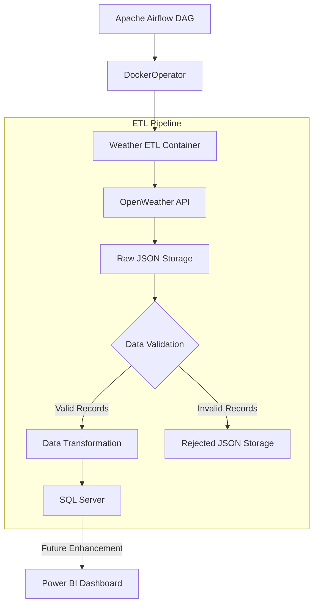
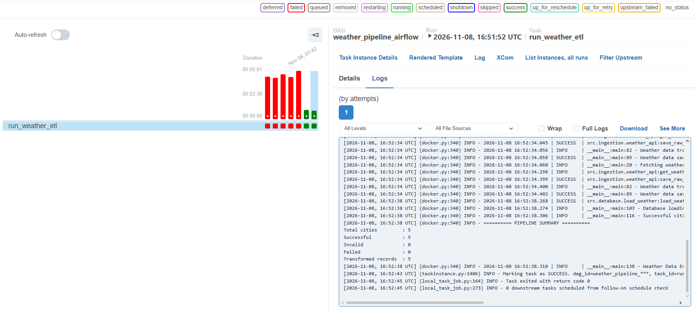
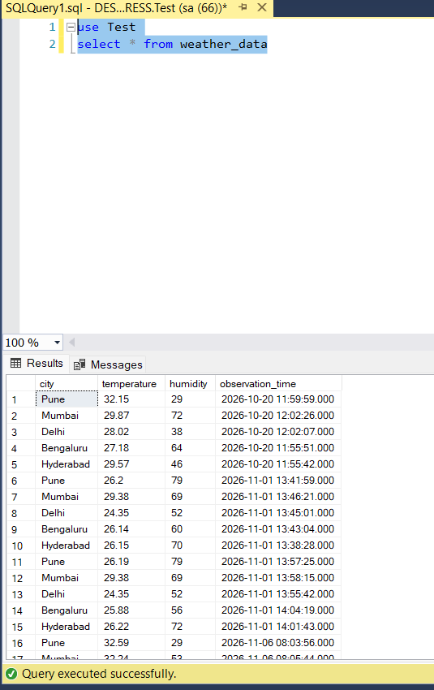

# 🌦️ Enterprise Weather Data Engineering Pipeline

An end-to-end, production-style data engineering project that extracts real-time weather data from the OpenWeather API, validates and transforms records using Python, and loads structured data into Microsoft SQL Server.

The pipeline is containerized using **Docker** and orchestrated using **Apache Airflow**.


---

## 📌 Project Overview

This project demonstrates the development of an automated ETL pipeline using industry-relevant data engineering technologies.

It processes weather information across multiple cities through an ingestion, validation, transformation and loading workflow.

### Key Highlights

- Multi-city weather data ingestion through a REST API.
- Raw JSON data storage.
- Data validation and error handling.
- Separate storage for rejected records.
- Structured data transformation using Python and Pandas.
- SQL Server database integration.
- Docker-based ETL execution.
- Apache Airflow orchestration using DockerOperator.
- Logging, exception handling and execution summaries.

---

## 🏗️ System Architecture

The following diagram represents the actual pipeline architecture.



---

## 🔄 ETL Workflow

| Stage | Description |
|---|---|
| Extract | Fetch weather information from OpenWeather API for configured cities. |
| Raw Storage | Save the original API responses as JSON files. |
| Validate | Check incoming records against defined validation rules. |
| Reject | Store invalid records separately with validation errors. |
| Transform | Convert valid weather data into structured records. |
| Load | Insert transformed records into Microsoft SQL Server. |
| Orchestrate | Execute the ETL container through an Apache Airflow DAG. |

---

## 🖥️ Technology Stack

| Category | Technologies |
|---|---|
| Programming | Python |
| API Integration | OpenWeather REST API, Requests |
| Data Processing | Pandas |
| Database | Microsoft SQL Server |
| Database Connectivity | SQLAlchemy, PyODBC |
| Logging | Loguru |
| Containerization | Docker |
| Orchestration | Apache Airflow, DockerOperator |
| Verification | Standalone Python scripts |
| Version Control | Git, GitHub |
| Future Visualization | Power BI |

---

## 📊 Project Execution Screenshots

### 1. Apache Airflow Orchestration

The `weather_pipeline_airflow` DAG executes the ETL pipeline inside a dedicated Docker container.



**Successful execution summary:**
- Total cities: 5
- Successful: 5
- Invalid: 0
- Failed: 0
- Transformed records: 5
- Container exit code: 0

### 2. SQL Server Data Output

The transformed weather records are loaded into the `weather_data` table in the `Test` database.



The SQL query below retrieves the loaded records:

```sql
USE Test;

SELECT *
FROM weather_data;
```

---

## 🐳 Docker Implementation

The ETL pipeline is packaged into a custom Docker image.

**Docker image:** `weather-etl:1.0`

The image contains:
- Python runtime and project dependencies.
- ETL application source code.
- Database connectivity dependencies.
- Required configuration and application files.

Apache Airflow uses the DockerOperator to execute this image independently of the Airflow worker's Python environment.

This separation allows the ETL application and orchestration environment to use their respective runtime dependencies.

---

## ⏱️ Apache Airflow Orchestration

The project uses an Airflow DAG named:

`weather_pipeline_airflow`

**DAG configuration:**
- Executor: CeleryExecutor
- Operator: DockerOperator
- Schedule: Manual trigger
- Retries: 2
- Retry delay: 2 minutes
- Docker image: `weather-etl:1.0`

The DAG triggers the Dockerized ETL pipeline and monitors its execution status.

---

## 📁 Project Structure

```text
weather-data-engineering-pipeline/
│
├── airflow/
│   └── weather_pipeline_dag.py
│
├── assets/
│   ├── airflow-dag.png
│   └── sql-server-output.png
│
├── config/
│   └── cities.py
│
├── src/
│   ├── database/
│   ├── ingestion/
│   ├── transformation/
│   ├── utils/
│   └── validation/
│
├── tests/
│   ├── test_logger.py
│   ├── test_pipeline_rejection.py
│   ├── test_rejected_data.py
│   ├── test_transformation.py
│   └── test_validation.py
│
├── .dockerignore
├── .gitignore
├── Dockerfile.etl
├── main.py
├── requirements.txt
└── README.md
```

---

## ⚙️ Local Setup and Execution

### Prerequisites

- Python
- Microsoft SQL Server
- ODBC Driver 17 for SQL Server
- OpenWeather API key
- Git

### 1. Clone the repository

```bash
git clone https://github.com/aditya15shinde-DE/weather-data-engineering-pipeline.git
cd weather-data-engineering-pipeline
```

### 2. Create a virtual environment

```bash
python -m venv .venv
```

### 3. Install dependencies

```bash
.venv\Scripts\python.exe -m pip install -r requirements.txt
```

### 4. Configure environment variables

Create a `.env` file in the project root.

```env
OPENWEATHER_API_KEY=your_api_key

SQL_SERVER=your_sql_server
SQL_PORT=your_sql_port
SQL_DATABASE=Test
SQL_USERNAME=your_username
SQL_PASSWORD=your_password
```

Use your own database connection details. Never commit your `.env` file or expose credentials in GitHub.

### 5. Execute the ETL pipeline

```bash
.venv\Scripts\python.exe main.py
```

---

## 🧪 Verification Scripts

The project includes standalone Python scripts to verify individual components and pipeline behavior.

Run them using:

```bash
.venv\Scripts\python.exe tests\test_validation.py

.venv\Scripts\python.exe tests\test_transformation.py

.venv\Scripts\python.exe tests\test_rejected_data.py

.venv\Scripts\python.exe tests\test_logger.py

.venv\Scripts\python.exe tests\test_pipeline_rejection.py
```

These scripts cover validation, transformation, rejected-data handling, logging and pipeline rejection behavior.

---

## 🚀 Future Enhancements

- Develop an interactive Power BI weather dashboard.
- Introduce historical weather data analysis.
- Implement automated data quality monitoring.
- Expand pipeline monitoring and alerting.
- Improve configuration portability across environments.

---

## 📌 Project Status

| Component | Status |
|---|---|
| API Ingestion | Completed |
| Raw JSON Storage | Completed |
| Data Validation | Completed |
| Rejected Data Handling | Completed |
| Data Transformation | Completed |
| SQL Server Integration | Completed |
| Logging and Error Handling | Completed |
| Docker Containerization | Completed |
| Airflow Orchestration | Completed |
| Power BI Dashboard | Planned |

---

**Built to demonstrate practical data engineering skills through an end-to-end ETL pipeline.**